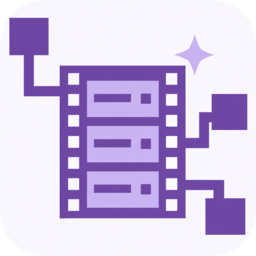

<div align="center">

<h1>RecotteStudio MCP</h1>
<p>
<a href="https://github.com/shun126/RecotteStudioMCP/stargazers"></a>
<a href="https://github.com/shun126/RecotteStudioMCP/blob/main/LICENSE"></a>
<a href="https://github.com/shun126/RecotteStudioMCP/releases"></a>
<a href="https://github.com/shun126/RecotteStudioMCP/releases"></a>
</p>
</div>

Recotte Studio の `.ccproj` プロジェクトを MCP クライアントから調査・作成・編集・保存する Windows アプリです。Recotte Studio 自体は起動せず、[RecotteStudio.Core](Source/RecotteStudio.Core/README.md) がプロジェクトファイルを処理します。

> 本プロジェクトは非公式ツールです。株式会社AHS および Recotte Studio の開発元とは関係ありません。

## 多言語の字幕ファイルを書き出す

Recotte Studio で作った動画の台詞から、英語・中国語などの字幕ファイル（`.srt`）を作成できます。MCP クライアントに頼むだけで、台詞の翻訳から字幕ファイルの書き出しまで済みます。

```text
MyMovie.ccproj の台詞を英語と中国語（簡体字）に翻訳して、字幕ファイルを書き出して
```

```text
MyMovie.en.srt                     MyMovie.zh-Hans.srt
1                                  1
00:00:00,600 --> 00:00:01,650      00:00:00,600 --> 00:00:01,650
Hello                              你好

2                                  2
00:00:01,600 --> 00:00:02,800      00:00:01,600 --> 00:00:02,800
Hi there!                          你好！
```

- 字幕の表示時間は、各台詞の開始・終了時刻と同じです。動画を編集し直しても、書き出し直すだけで字幕を合わせられます。
- 翻訳しなければ、日本語の字幕ファイルを書き出せます。
- `.srt` は YouTube の字幕や、一般的な動画編集ソフト・動画プレーヤーで読み込めます。
- 字幕の書き出しではプロジェクトを変更しません。

台詞の翻訳は MCP クライアント（Claude、Codex など）が行います。詳しい仕組みは[字幕ファイルの書き出し](Documents/RecotteStudioCore/Subtitles.md)を参照してください。

## 縦動画（ショート）を作る

YouTube ショート、TikTok、Instagram リール向けの縦長（1080×1920）のプロジェクトを作れます。作成済みの横長のプロジェクトを縦に作り直すこともできます。

```text
縦動画のショートとして、新しいプロジェクト Short.ccproj を作って
```

```text
MyMovie.ccproj を縦動画にして、MyMovie_short.ccproj として保存して
```

- 新規作成では、画面サイズを指定できます。字幕枠は縦画面に合わせて配置されます。
- 画面サイズを変えると、字幕枠・キャラクター・画像・動画が新しい画面に合わせて配置し直されます。画面いっぱいの背景は中央を切り抜いて埋めるか、全体を残して余白を付けるかを選べます。
- 横長のプロジェクトからキャラクターを取り込んでも、縦画面に合わせて配置されます。
- 静止画から作る動画素材も、縦画面の解像度で書き出します。

自動の配置は目安です。字幕と重なる素材は MCP クライアントが位置を調整しますが、仕上がりは Recotte Studio で確認してください。

## 画像から動画素材を作る

静止画から動画素材（`.mp4`）を作れます。写真やイラストに動きを付けたり、複数の画像をパラパラアニメにしたりして、背景や挿絵として使えます。

```text
castle.jpg をゆっくりズームインする 5 秒の動画にして、MyMovie.ccproj の冒頭に配置して
```

```text
walk1.png から walk4.png を 1 秒に 8 枚のパラパラアニメにして、3 回繰り返して
```

- ズームイン・ズームアウト、上下左右へのパンを選べます。字幕の帯に顔などがかからないよう、ズームの中心も指定できます。
- パラパラアニメでは、画像ごとに表示時間を変えたり、同じ画像を何度も使ったりできます。透明な部分は背景色で埋めます。
- 解像度とフレームレートはプロジェクトに合わせ、Recotte Studio が読み込める形式（H.264 / AAC）で書き出します。
- 画像とプロジェクトは変更しません。配置は既存の編集ツールで行うので、保存前に変更内容を確認できます。

この機能には [ffmpeg](https://ffmpeg.org/) が必要です。ffmpeg は同梱していないため、`winget install Gyan.FFmpeg` などでインストールし、設定画面の「ffmpeg」で `ffmpeg.exe` を指定してください。PATH に ffmpeg がある場合は指定不要です。詳しくは[画像から動画素材を作る](Documents/RecotteStudioCore/VideoFromImage.md)を参照してください。

## LLM向け動画制作ルール

RecotteStudioMCP は、動画制作のガイドラインを `recotte_get_generation_rules` で提供します。Codex や Claude Code などのMCPクライアントには、プロジェクトを生成・編集する前にこのツールを呼び出すよう、初期指示とツールの説明で案内します。ルールには読み上げ音声を別途生成しないこと、字幕を画像に描き込まないこと、字幕枠の扱い、静止画を動画素材にする機能の使いどころなどが含まれます。

配布ZIPには、実行ファイルと同じフォルダに **編集可能な `GenerationRules.md`** を収録しています。MCPツールは呼び出すたびにこのファイルを読み直すため、利用者は再起動や再ビルドをせずにルールを変更できます。ファイルが存在しない場合はアプリのアクティビティに警告を記録しますが、MCPサーバーやプロジェクト操作は継続し、取得ツールは `available=false` と空の `content` を返します。LLMは必ずツールを呼ぶとは限らないため、制作前に「`recotte_get_generation_rules` を読んでから作って」と指定することもできます。

`GenerationRules.md` は更新のたびに配布版で上書きされます。独自のルールは **`%LOCALAPPDATA%\RecotteStudioMCP\UserRules.md`** に Markdown で書いてください。このファイルは更新しても上書きされず、`recotte_get_generation_rules` が `GenerationRules.md` と一緒に `userRules` として返します。ルールが食い違う場合は `UserRules.md` が優先されます。ファイルが無い、または空の場合は何もしません。設定画面の「ユーザールール」から、このフォルダを開けます。

```markdown
# 私のルール

- 立ち絵は画面の右側に置く。
- 1つの台詞は40文字以内にする。
```

## できること

- プロジェクトの調査: レイヤー、タイムライン、台詞、画面と字幕枠の配置を確認し、プロジェクトを検証します。
- プロジェクトの作成と編集: 横長・縦長（ショート）の画面サイズでの作成と画面サイズの変更、台詞の追加・書き換え、画像・動画・注釈テキスト・スタンプの配置、クリップの移動・削除、画像・動画のフェードを扱えます。動画レイヤーと注釈レイヤーの追加や、別のプロジェクトからのキャラクターの取り込みもできます。
- 字幕ファイルの書き出し: 台詞を `.srt` として書き出します。翻訳した字幕も作れます。
- 動画素材の作成: ffmpeg を使い、静止画にズームやパンを付けた動画や、複数の静止画をつないだパラパラアニメを作ります。
- 安全な保存: 別名で保存するか、バックアップを取ってから上書きします。保存前に変更内容と検証結果を確認できます。

## Recotte Studio とは

[Recotte Studio](https://www.recottestudio.com/) は、株式会社AHS の Windows 向け動画編集ソフトです。3D / 2D のキャラクターと音声合成を組み合わせて、解説動画などを手軽に作成できます。

- VOICEPEAK や VOICEVOX などの音声合成ソフトと連携し、テキストから読み上げ音声付きの動画を作成
- 3D モデルや 2D 立ち絵のキャラクターに対応し、口パク・まばたき・表情変更が可能
- カット編集、テロップ、図形、エフェクトなどの一般的な動画編集機能

無料で使える [Recotte Studio Basic](https://www.recottestudio.com/) と、機能を拡張した [製品版](https://www.ah-soft.com/rs/) があります。本ツールが扱う `.ccproj` は Recotte Studio のプロジェクトファイルです。生成したプロジェクトを開いて動画に書き出すには Recotte Studio が必要ですが、Basic の機能の範囲内であれば無料の Recotte Studio Basic でも利用できます。

## 使い始める

1. [Releases](https://github.com/shun126/RecotteStudioMCP/releases) の `RecotteStudioMCP-<バージョン>-win-x64.zip`（例: `RecotteStudioMCP-0.6.5-win-x64.zip`）を展開します。
2. `RecotteStudio.McpServer.exe` を起動します。ウィンドウが開いている間、`http://127.0.0.1:8765/mcp` で MCP サーバーが稼働します。最小化しても稼働し、閉じると停止します。
3. 必要なら画面左下の設定を開き、作業フォルダを指定して「作業フォルダを適用」を押します。未指定の場合は従来どおり、既存ディレクトリ内の任意の `.ccproj` を扱えます。
4. 設定画面の Codex または Claude Code の接続例をコピーして接続します。接続例にはこの PC 専用の接続トークンが含まれるため、公開しないでください。

接続先は固定です。ポート `8765` が使用中なら、アプリにエラーが表示されます。別のアプリでこのポートを使用している場合は、そのアプリを終了してから Recotte Studio MCP を再起動してください。

### Codex

画面の「Codex 設定をコピー」で得た内容を `%USERPROFILE%\.codex\config.toml` に追加します。旧 `[mcp_servers.recotte]` がある場合は削除し、`[mcp_servers.recotte_studio]` を追加・置換してください。新しい Codex セッションで接続を確認します。Codex のHTTPサーバー設定では `url` と `http_headers` を使用します。

### Claude Code

設定画面の「Claude Code 設定をコピー」で得たJSONを `%USERPROFILE%\.claude.json` のトップレベル `mcpServers.recotte_studio` に追加します。旧 `mcpServers.recotte` があれば削除し、他の設定は残してください。新しいセッションで接続を確認します。設定例にはトークンが含まれるため、このファイルを共有しないでください。Claude Code のユーザー範囲MCP設定では `~/.claude.json` の `mcpServers` を使用します。

トークンを再発行すると既存のクライアント設定は使えなくなります。画面から設定例をコピーし直してください。クライアントの設定ファイルはアプリから変更しません。

設定画面には Codex と Claude Code それぞれの「エージェントへの設定依頼文をコピー」もあります。コピーした文を対象のエージェントに送ると、他の設定を残しながら旧 `recotte` を `recotte_studio` に移行できます。依頼文には接続トークンが含まれるため、送信先と会話履歴の取り扱いを確認してください。

## 開発

.NET 9 SDK と Windows App SDK の NuGet パッケージを使用します。

```powershell
dotnet build RecotteStudioMCP.sln
dotnet test RecotteStudioMCP.sln
```

| 場所 | 内容 |
| --- | --- |
| `Source/RecotteStudio.McpServer` | WinUI 3 画面、HTTP サーバー、MCP ツール群 |
| `Source/RecotteStudio.Core` | `.ccproj` を扱う SDK |
| `Source/*.Tests` | xUnit テスト |
| [Documents](Documents/README.md) | ファイル形式と Core の設計資料 |

本プロジェクトは AHS および Recotte Studio の開発元とは関係のない非公式ツールです。ライセンスは [GPL-3.0](LICENSE) です。
